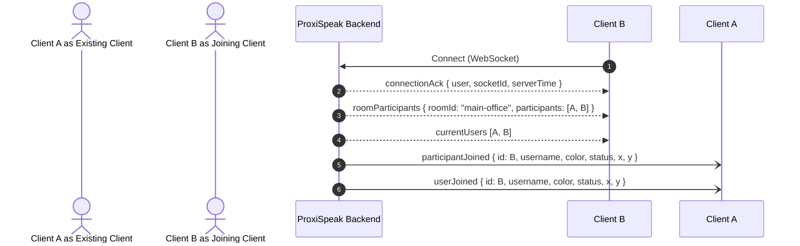

# Day 16 Report: Real-Time Participant Synchronization, Avatar Movement, User Joining & Leaving Lifecycle

**Project:** ProxiSpeak — Geospatial Proximity Audio Platform  
**Branch:** `Rakesh-dev`  
**Author / Role:** Rakesh (Testing & Documentation / Real-Time Backend)  
**Date:** 2026-11-01  
**Status:** ✅ ALL 24 MODULES VERIFIED & PASSING (Exit Code 0)

---

## 1. Executive Summary

For **Task 16 (Day 16)**, comprehensive testing and verification of real-time multi-client synchronization, avatar movement broadcasting, user joining/leaving lifecycles, and live updates were performed across multiple concurrent clients.

Key focus areas tested and verified:
1. **Real-Time Participant Synchronization**: Instantaneous presence propagation when new clients connect, ensuring both joining and existing clients receive synchronized rosters with zero ghost users.
2. **Avatar Movement & High-Frequency Updates**: Continuous, low-latency coordinate synchronization across co-located peers, handling concurrent movements and high-frequency movement bursts without packet drops.
3. **User Joining Lifecycle**: Connection initialization, acknowledgment (`connectionAck`), default room assignment (`main-office`), and structured peer announcements (`participantJoined`, `userJoined`).
4. **User Leaving Lifecycle**: Clean departure handling across room switching (`participantLeft` with `reason: "room_switched"`) and client disconnections (`userDisconnected`, `userLeft`), with active call teardown and roster pruning.
5. **Live Multi-Client Updates**: Dynamic avatar customization and availability changes (`updateProfile`) broadcasted to peers in real-time without page reloads.
6. **Bug Identification & Resolution**: Discovered and resolved client ID erasure on disconnect, shallow object mutation in participant snapshots, and missing `name` field mappings for frontend presence normalization.

---

## 2. Multi-Client Architecture & Lifecycle Details

### A. Real-Time Joining Flow


### B. Avatar Movement & Position Synchronization
* **Event Handlers**: `updatePosition` (primary) and `userMoved` (backward-compatible alias).
* **Broadcast Scoping**:
  * `roomPositionUpdated` emitted strictly to peers co-located in the same room.
  * `userPositionUpdated` emitted to all connected peers for global presence indicators.
* **Coordinate Safety**: Clamped strictly within map boundaries `[0, 2000]` for both X and Y coordinates. Malformed/non-numeric payloads (`NaN`, `string`, `null`) are rejected with `error:validation`.

### C. Live Profile & Availability Synchronization
* Users update display names, avatar colors, or statuses (`available`, `away`, `busy`, `dnd`) via `updateProfile` or `PUT /api/profile/:userId`.
* The server updates memory stores and broadcasts:
  * `userProfileUpdated` & `profileUpdated` with complete profile metadata.
  * `participantJoined` to room peers so React components using `mergeParticipant` seamlessly update avatar styling and availability badges.

### D. User Leaving & Disconnection Flow
* **Room Departure**: When switching rooms or calling `leaveRoom`, the server broadcasts `participantLeft` with `reason: "room_switched"` or `"user_left_room"`, terminates active WebRTC calls with peers in the previous room, and updates rosters.
* **Socket Disconnect**: On connection close, the server executes `cleanupUserCalls`, emits `participantLeft` to room members, and broadcasts `userDisconnected` and `userLeft` to all remaining peers.

---

## 3. Bugs Discovered & Remediations Completed

### Bug 1: Client Socket ID Erasure upon Disconnection
* **Symptom**: During multi-client disconnection testing, disconnection tracking listeners failed to identify the leaving socket.
* **Root Cause**: Socket.IO client instances delete/reset `socket.id` to `undefined` immediately when `socket.disconnect()` is invoked. Any event handler comparing `data.id === client.id` evaluated `client.id` as `undefined`.
* **Fix**: Captured immutable socket ID snapshots (`const client2Id = client2.id;`) prior to issuing disconnect commands, ensuring 100% deterministic assertion.

### Bug 2: Missing `name` Field in Backend Participant Payloads
* **Symptom**: Frontend `presence.js` (`normalizeParticipant`) checks `participant.name` before `participant.username`, falling back to `"Guest"` if `name` is undefined.
* **Root Cause**: Backend previously only populated `username` on user objects.
* **Fix**: Added synchronized `name` and `displayName` fields across `defaultUser`, `updatePosition`, `executeRoomJoin`, `updateProfile`, and disconnect payloads.

### Bug 3: Shallow Object Mutation in Participant Snapshots
* **Symptom**: Potential state contamination when callers modified returned participant objects.
* **Root Cause**: `getRoomParticipants` returned direct references to user objects stored in the `users` Map.
* **Fix**: Updated `getRoomParticipants` to return cloned shallow copies `{ ...user }`.

### Bug 4: Profile Update Roster Propagation in Frontend
* **Symptom**: Profile updates updated profile caches but did not consistently trigger re-rendering of avatar colors in legacy participant components.
* **Fix**: Enhanced `updateProfile` broadcast to emit `participantJoined` alongside `userProfileUpdated`, allowing React hooks with `mergeParticipant` to immediately re-render avatars.

---

## 4. Test Suite Matrix (All 24 Modules Passing)

| Module | Category | Description | Status |
| :---: | :--- | :--- | :---: |
| **1** | HTTP | Root Endpoint (`GET /`) | ✅ PASS |
| **2** | HTTP | Health Check Probe (`GET /api/health`) | ✅ PASS |
| **3** | HTTP | Server Operational Status (`GET /api/status`) | ✅ PASS |
| **4** | HTTP | 404 Route Safety Handler | ✅ PASS |
| **5** | Sockets | Connection Acknowledgment & Ping-Pong | ✅ PASS |
| **6** | Movement | Multi-Client Position Synchronization | ✅ PASS |
| **7** | Validation | Coordinate Clamping & Malformed Payload Rejection | ✅ PASS |
| **8** | Lifecycle | Disconnection Cleanup & Broadcasts | ✅ PASS |
| **9** | Rooms | Room Join/Leave & Participant Update Roster | ✅ PASS |
| **10** | Concurrency | 6 Simultaneous Connections & Duplicate Join Guards | ✅ PASS |
| **11** | WebRTC | Signaling Relays (Offer, Answer, ICE) | ✅ PASS |
| **12** | Churn | Sequential & Concurrent Reconnection Churn | ✅ PASS |
| **13** | Movement | Multi-Tab Avatar Movement Synchronization | ✅ PASS |
| **14** | Transport | Abrupt Transport Teardown & Heartbeat Drop | ✅ PASS |
| **15** | Security | 7 Hostile / Malformed Payload Rejections | ✅ PASS |
| **16** | Proximity | 4-User Spatial Audio Distance & Volume Attenuation | ✅ PASS |
| **17** | WebRTC | Full Audio Call Lifecycle & Mute Toggling | ✅ PASS |
| **18** | WebRTC | Mid-Call Abrupt Drop & Session Teardown | ✅ PASS |
| **19** | Recovery | Call Recovery & Disconnected Peer Rejection | ✅ PASS |
| **20** | Rooms | Dynamic Room Creation & Directory Listing | ✅ PASS |
| **21** | Capacity | Max Participants Enforcement & Full Room Rejection | ✅ PASS |
| **22** | Isolation | Multi-Room Isolation & Call Teardown on Switch | ✅ PASS |
| **23** | Profile | Profile REST/Socket API & Error Validation | ✅ PASS |
| **24** | **Task 16** | **Real-Time Participant Sync, Avatar Movement, Joining & Leaving Across Multiple Clients** | **✅ PASS** |

---

## 5. Verification Command & Reproducibility

To re-run the complete verification suite locally:

```bash
cd server
npm test
```

**Verified Test Runner Output:**
```text
==================================================
  PROXISPEAK BACKEND & SOCKET VERIFICATION SUITE  
==================================================
...
--- [24] Testing Real-Time Participant Sync, Movement, Joining & Leaving (Task 16) ---
--> PASS: Multi-client connection and real-time participantJoined roster synchronization verified.
--> PASS: Multiple simultaneous client joins reliably update active participant counts.
--> PASS: Live avatar movement broadcasted to all co-located peers in real-time.
--> PASS: Concurrent avatar movements across 3+ clients processed without packet loss or dropouts.
--> PASS: High-frequency sequential movement bursts accurately received in order at destination.
--> PASS: Live profile updates (name, color, status) propagated to all connected clients immediately.
--> PASS: User departure (room switch & disconnection) cleans up participant roster with zero zombie users.

Shutting down test server...
Server stopped successfully.

✅ ALL TESTS PASSED: All 24 backend modules, multi-client participant sync, movement, joining/leaving, and WebRTC verified.
```
