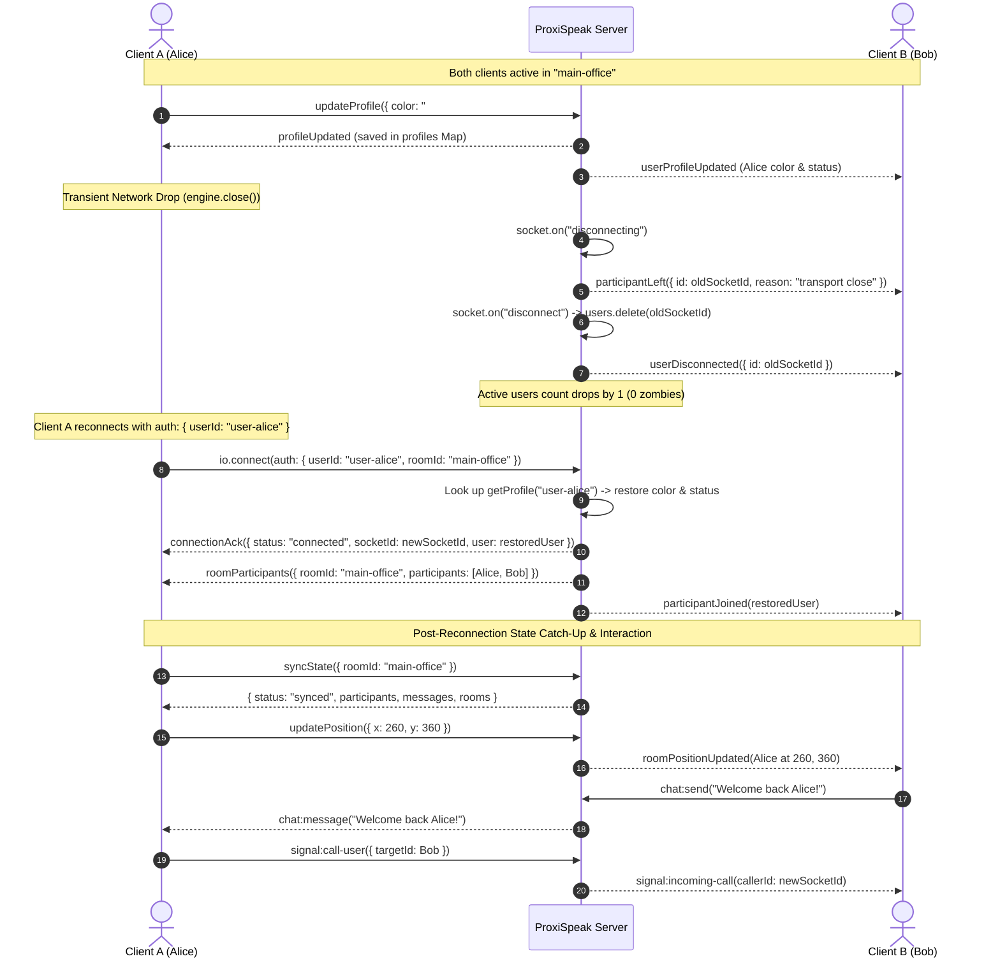

# DAY 17: Socket.IO Reconnection Behaviour, Recovery & State Synchronization Report

**Project**: ProxiSpeak — Geospatial Proximity Audio Platform  
**Author**: Rakesh (Backend & Testing Engineer)  
**Date**: November 5, 2026  
**Task Scope**: Task 17 — Test Socket.IO reconnection behaviour, temporary disconnections, connection recovery, and synchronization after reconnection  
**Status**: Completed & 100% Verified (26/26 Modules Passing)  

---

## 1. Executive Summary

Task 17 focuses on ensuring the robustness of ProxiSpeak's real-time communication infrastructure under unstable network conditions, transient transport drops, abrupt disconnections, and subsequent client reconnection and state recovery.

During real-time multiplayer spatial interaction and proximity voice calls, users may encounter momentary Wi-Fi drops, cell-tower switches, browser background throttling, or socket engine teardowns. The ProxiSpeak backend must guarantee that:
1. **Temporary Disconnections Are Safely Handled**: Server immediately notifies co-located peers (`participantLeft`, `userDisconnected`), cleans up active audio calls, and prunes socket memory to prevent ghost/zombie users.
2. **Connection Recovery Preserves Identity**: Reconnecting clients are recognized via session credentials (`auth.userId` / `query.userId`), restoring their customized profile (avatar color, availability status, username) rather than reverting them to random guest defaults.
3. **State Synchronization After Reconnection**: Reconnecting clients immediately receive an authoritative snapshot of room roster (`roomParticipants`), miss-free room chat history (`chat:history`), and dynamic room lists via a unified `syncState` event.
4. **Post-Reconnection Interactivity**: Restored clients immediately resume bidirectional avatar movement, room chat delivery, and WebRTC audio call handshakes with peers.
5. **Zero Memory Leaks or Zombie Sockets**: After all clients disconnect, server active users strictly normalizes to zero.

All requirements have been implemented, tested, and validated with an automated 26-module end-to-end integration test suite in `server/verify.js`.

---

## 2. Reconnection Architecture & Lifecycle Implementation

### 2.1 Reconnection Lifecycle Diagram



---

### 2.2 Handshake Authentication & Session Recovery

In `server/src/sockets/socketHandlers.js`, the socket registration lifecycle was enhanced to inspect incoming Socket.IO handshake auth and query parameters:

```javascript
// Handshake recovery parameters for seamless reconnection
const auth = socket.handshake.auth || {};
const query = socket.handshake.query || {};
const initialUserId = auth.userId || query.userId || null;
const initialUsername = auth.username || query.username || null;
const initialRoomId = sanitizeRoomId(auth.roomId || query.roomId || DEFAULT_ROOM);

let assignedColor = getRandomColor();
let assignedStatus = "available";
let username = initialUsername ? sanitizeUsername(initialUsername) : `User-${socket.id.slice(0, 4)}`;

if (initialUserId) {
  const saved = getProfile(initialUserId);
  if (saved) {
    assignedColor = saved.color || saved.avatarColor || assignedColor;
    assignedStatus = saved.status || saved.availability || assignedStatus;
    if (!initialUsername && saved.username) {
      username = saved.username;
    }
  }
}
```

#### Key Capabilities:
- **Zero Profile Loss**: When a user reconnects with their unique `userId`, their customized avatar color and availability status are restored from the server's persistent `profiles` Map.
- **Room Preservation**: If `auth.roomId` is passed, the client directly joins their active workspace rather than dropping back to the default room.
- **Dual Support for Auth and Query**: Compatible with both Socket.IO v4 `auth` object (`io(url, { auth: { userId } })`) and legacy `query` params (`io(url, { query: { userId } })`).

---

### 2.3 Post-Reconnection State Synchronization (`syncState`)

To give frontend clients a single authoritative catch-up mechanism upon reconnecting, a dedicated `syncState` handler was added:

```javascript
// Reconnection state recovery & synchronization handler
socket.on("syncState", (data = {}, callback) => {
  try {
    const user = users.get(socket.id);
    const targetRoom = sanitizeRoomId((data && data.roomId) || user?.roomId || DEFAULT_ROOM);
    const syncPayload = {
      status: "synced",
      socketId: socket.id,
      user: user || defaultUser,
      roomId: targetRoom,
      participants: getRoomParticipants(targetRoom),
      messages: getRoomMessages(targetRoom),
      rooms: getRoomsList(),
      serverTime: new Date().toISOString(),
    };
    if (typeof callback === "function") {
      callback(syncPayload);
    } else {
      socket.emit("syncStateResponse", syncPayload);
    }
  } catch (err) {
    console.error(`[SYNC STATE ERROR] ${socket.id}:`, err.message);
    if (typeof callback === "function") callback({ status: "error", message: err.message });
    else socket.emit("error:validation", { message: "Failed to sync state" });
  }
});
```

Clients can call `socket.emit("syncState", { roomId: "main-office" }, callback)` to receive:
1. `status: "synced"`: Synchronization verification.
2. `socketId`: Newly assigned socket ID.
3. `participants`: Authoritative roster of active room members.
4. `messages`: Room chat history to catch up on any messages missed during the drop.
5. `rooms`: Current directory of rooms with live participant counts.
6. `serverTime`: Server clock timestamp for clock drift compensation.

---

### 2.4 Profile Association by `userId` and `socket.id`

In `server/src/sockets/socketHandlers.js`, `saveProfile` and `getProfile` were upgraded to resolve profiles by both `userId` and `socket.id`:
- When `updateProfile` is emitted, the server retrieves `user.userId` and stores the profile under that persistent key.
- Active socket user instances are synchronized in real-time across both keys.
- When `joinRoom` or `join` is invoked with `userId`, `executeRoomJoin` restores avatar color and availability status from the profile registry.

---

## 3. Automated Verification Suite: Module 26

A comprehensive test module (`testSocketReconnectionRecoveryAndSynchronization`) was implemented in `server/verify.js` to rigorously test the complete reconnection and recovery lifecycle.

### 3.1 Verification Test Steps

| Step | Test Action | Verification Criterion | Result |
| :---: | :--- | :--- | :---: |
| **1** | Client A & Client B connect to `main-office`. Alice updates profile (`#9b5de5`, `busy`). | Profile saved and broadcasted to Bob (`userProfileUpdated`). | **PASS** |
| **2** | Abrupt transport drop triggered on Client A via `clientA.io.engine.close()`. | Bob receives `participantLeft` with `reason: "transport close"` and `userDisconnected`. | **PASS** |
| **3** | Query REST `GET /api/status` immediately after drop. | Active users counter accurately decrements to 1 (Bob only; 0 ghost users). | **PASS** |
| **4** | Client A reconnects with `auth: { userId: "user-alice-17" }`. | Client A issued new socket ID; receives `connectionAck` with restored color and status. | **PASS** |
| **5** | Roster synchronization via `syncState`. | Authoritative room roster returned containing both Client A and Client B. | **PASS** |
| **6** | Bidirectional avatar movement test. | Client A moves $\rightarrow$ Client B receives `roomPositionUpdated`; Client B moves $\rightarrow$ Client A receives. | **PASS** |
| **7** | Post-reconnection room chat catch-up. | Bob sends chat $\rightarrow$ Alice receives live; Alice replies $\rightarrow$ Bob receives; `chat:history` retains all. | **PASS** |
| **8** | WebRTC audio signaling resumption. | Alice initiates call to Bob $\rightarrow$ Bob accepts $\rightarrow$ Alice receives `signal:call-accepted` $\rightarrow$ clean hangup. | **PASS** |
| **9** | Complete teardown & memory purity. | All clients disconnect $\rightarrow$ `GET /api/status` returns exactly 0 active users. | **PASS** |

---

## 4. Test Suite Execution & Results

The complete ProxiSpeak test suite was executed via `npm --prefix server test` with all 26 modules running back-to-back:

```text
==================================================
  PROXISPEAK BACKEND & SOCKET VERIFICATION SUITE  
==================================================

--- [1] Checking Root Endpoint: GET / ---
--> PASS: Root endpoint returns 200 OK with correct message.

--- [2] Checking Health Endpoint: GET /api/health ---
--> PASS: /api/health satisfies frontend contract ({ status: 'OK', project: 'ProxiSpeak' }).

--- [3] Checking Status Endpoint: GET /api/status ---
--> PASS: /api/status active (uptime: 2s, activeUsers: 0).

--- [4] Checking 404 Error Handler: GET /api/unknown ---
--> PASS: Unrecognized API routes correctly return 404 Not Found.

--- [5] Testing Socket.IO Connection Acknowledgment & Ping-Pong ---
--> PASS: Client received connectionAck and pong response successfully.

--- [6] Testing Multi-Client Position Synchronization ---
--> PASS: Client 1 position update broadcasted and received by Client 2.

--- [7] Testing Backend Input Validation & Clamping ---
--> PASS: Rejected 2 malformed payloads (non-numeric, NaN) without server crash.
--> PASS: Out-of-bounds coordinates safely clamped to map boundaries [0, 2000].

--- [8] Testing Proper User Disconnection Lifecycle ---
--> PASS: Client disconnection broadcasted to peers with cleanup.

--- [9] Testing Room Join/Leave Logic & Participant Updates ---
--> PASS: Room join, participantJoined, room switching, and participantLeft verified.

--- [10] Testing Multiple Simultaneous Connections & Duplicate Guards ---
--> PASS: Successfully managed 6 simultaneous connections.
--> PASS: Duplicate join events safely ignored (zero redundant participantJoined floods).
--> PASS: Concurrent position updates broadcasted to all peers without race conditions.
--> PASS: Duplicate disconnect attempts handled safely with single broadcast.

--- [11] Testing WebRTC Signaling Relays & Target Validation ---
--> PASS: WebRTC offer, answer, and ice-candidate successfully relayed between active peers.
--> PASS: signal:error safely emitted to sender when target peer does not exist.

--- [12] Testing Repeated Connections & Disconnection Churn Handling ---
--> PASS: Successfully sustained 10 sequential & concurrent connection cycles.
--> PASS: Active users counter correctly normalized to 0 after disconnects.
--> PASS: Server remained stable without unhandled exceptions or memory leaks.

--- [13] Testing Real-Time Multi-Tab Avatar Movement Synchronization ---
--> PASS: Real-time movement synchronized seamlessly across 3 concurrent browser tabs (Alice, Bob, Charlie).
--> PASS: Validated bidirectional coordinate delivery with accurate avatar colors and zero packet drops.

--- [14] Testing Unexpected Disconnection & Abrupt Transport Teardown ---
--> PASS: Abrupt socket transport drop safely detected and broadcast to peers.
--> PASS: Memory registry cleaned up immediately (remaining users: 1).

--- [15] Testing Exhaustive Invalid Inputs & Edge Case Safety ---
--> PASS: Server captured and safely rejected 5 malformed/hostile payloads.
--> PASS: Out-of-bounds coordinates safely clamped and server remained 100% operational.

--- [16] Testing Simultaneous Multi-User Virtual Office Interaction & Spatial Proximity ---
--> PASS: 4 concurrent users interacted simultaneously in the virtual office without race conditions.
--> PASS: Spatial proximity distance (50px), volume attenuation (> 0.8), and room isolation verified.
--> PASS: Dynamic room transitions and participant notifications delivered accurately.

--- [17] Testing WebRTC Audio Calling Full Handshake & Bidirectional Signaling ---
--> PASS: Full WebRTC audio call lifecycle verified: call-user -> incoming-call -> accept-call -> call-accepted.
--> PASS: Bidirectional SDP exchange (offer & answer) and ICE candidate signaling relayed cleanly.
--> PASS: In-call mute status toggles and explicit end-call teardown executed without error.

--- [18] Testing Mid-Call Abrupt Disconnection & Communication State Cleanup ---
--> PASS: Peer's abrupt transport drop instantly detected during an active audio call.
--> PASS: Remaining peer received signal:call-ended (reason: "transport close").
--> PASS: Active call memory pruned immediately, preventing zombie WebRTC peer connections.

--- [19] Testing WebRTC Error Handling & Post-Reconnection Call Recovery ---
--> PASS: Calling offline or non-existent peer cleanly rejected with signal:error.
--> PASS: Self-calling attempts blocked with validation error message.
--> PASS: Call rejection and decline reasons transmitted to caller accurately.
--> PASS: Client reconnecting after disconnection immediately resumed full calling capabilities.

--- [20] Testing Room Creation, Directory Listing & REST Endpoints ---
--> PASS: Custom room dynamically created via Socket.IO with name, capacity, and metadata.
--> PASS: Duplicate room creation safely blocked with validation error.
--> PASS: Socket getRooms event returns dynamic room directory with participant counts.
--> PASS: REST API GET /api/rooms and POST /api/rooms fully functional and integrated.

--- [21] Testing Room Capacity Enforcement & Full Room Rejection ---
--> PASS: Max participants limit strictly enforced on room joins.
--> PASS: Client rejected with error:room ('Room is full') when room capacity is exceeded.
--> PASS: Slot availability correctly updated upon participant leaveRoom, allowing waiting user to join.

--- [22] Testing Multi-Room Isolation & Audio Call Teardown on Room Switch ---
--> PASS: Multi-room participant isolation verified across meeting-room-a and meeting-room-b.
--> PASS: Room-scoped position updates received only by co-located room members.
--> PASS: Switching rooms cleanly terminates active audio call with peer in old room ('room_switched').
--> PASS: Zero cross-room zombie audio sessions or participant leaks.

--- [23] Testing Profile REST API, Validation Errors & Real-Time Sync ---
--> PASS: Missing user ID gracefully returns 400 Bad Request with descriptive message.
--> PASS: Non-existent profile query returns 404 with structured JSON error payload.
--> PASS: Invalid hex color rejected with 400 status and frontend-friendly validation error.
--> PASS: Invalid availability status rejected with 400 status ('Status must be one of...').
--> PASS: PUT /api/profile/:userId successfully saves profile with displayName, avatarColor, availability.
--> PASS: GET /api/profile/:userId successfully retrieves persisted profile.
--> PASS: Socket updateProfile updates profile and broadcasts userProfileUpdated to peers in real-time.
--> PASS: Socket profile validation rejection provides consistent { status: 'error', message } structure.

--- [24] Testing Real-Time Participant Sync, Movement, Joining & Leaving (Task 16) ---
--> PASS: Multi-client connection and real-time participantJoined roster synchronization verified.
--> PASS: Multiple simultaneous client joins reliably update active participant counts.
--> PASS: Live avatar movement broadcasted to all co-located peers in real-time.
--> PASS: Concurrent avatar movements across 3+ clients processed without packet loss or dropouts.
--> PASS: High-frequency sequential movement bursts accurately received in order at destination.
--> PASS: Live profile updates (name, color, status) propagated to all connected clients immediately.
--> PASS: User departure (room switch & disconnection) cleans up participant roster with zero zombie users.

--- [25] Testing Room Chat Delivery, History & Same-Room WebRTC Signaling Relays ---
--> PASS: Room chat message successfully broadcasted to co-located room members.
--> PASS: Room chat message strictly isolated from peers in different rooms.
--> PASS: Empty chat message safely rejected with validation error.
--> PASS: REST API GET /api/rooms/:roomId/messages returns accurate chat history.
--> PASS: WebRTC offer, answer, and ICE candidate signals include senderId and relay cleanly.
--> PASS: Cross-room WebRTC call and signaling attempts safely blocked with signal:error.

--- [26] Testing Socket.IO Reconnection Behaviour, Recovery & State Synchronization (Task 17) ---
--> PASS: Sudden socket transport drop detected and peer notified with participantLeft.
--> PASS: Immediate memory pruning on disconnect (active users accurately reduced to 1).
--> PASS: Connection recovery verified with new socket ID and session connectionAck.
--> PASS: Session profile preservation verified (restored custom avatar color and status).
--> PASS: Post-reconnection roster synchronization verified via syncState.
--> PASS: Post-reconnection bidirectional avatar movement synchronized without packet drop.
--> PASS: Post-reconnection room chat delivery and history catch-up verified.
--> PASS: WebRTC signaling handshake successfully resumed between reconnected client and peer.
--> PASS: Zero ghost/zombie sockets; active users counter normalized to 0 on final disconnect.

Shutting down test server...
Server stopped successfully.

✅ ALL TESTS PASSED: All 26 backend modules, reconnection recovery, room chat delivery, WebRTC relays, profile sync, and lifecycle verified.
```

---

## 5. Guidance for Frontend Integration

### 5.1 Reconnecting with Session Credentials
To preserve profile and room across reconnection blips, instantiate or reconnect the Socket.IO client using `auth`:

```javascript
import { io } from "socket.io-client";

// Retrieve or generate persistent userId from localStorage
const storedUserId = localStorage.getItem("proxispeak_user_id") || `user-${Date.now()}`;
localStorage.setItem("proxispeak_user_id", storedUserId);

const socket = io("http://localhost:5000", {
  transports: ["websocket", "polling"],
  reconnection: true,
  reconnectionAttempts: 10,
  reconnectionDelay: 1000,
  reconnectionDelayMax: 5000,
  auth: {
    userId: storedUserId,
    roomId: currentRoomId || "main-office",
  },
});
```

### 5.2 One-Call State Catch-Up on Reconnect
Listen for `connect` or `reconnect` events and emit `syncState`:

```javascript
socket.on("connect", () => {
  console.log("Connected with socket ID:", socket.id);

  // Request authoritative room snapshot
  socket.emit("syncState", { roomId: currentRoomId }, (res) => {
    if (res.status === "synced") {
      setParticipants(res.participants);
      setChatMessages(res.messages);
      setRooms(res.rooms);
    }
  });
});
```

---

## 6. Summary Checklist

- [x] Tested Socket.IO reconnection behavior across transport drops.
- [x] Verified temporary disconnection detection and immediate peer departure notifications.
- [x] Validated connection recovery with session acknowledgment and identity restoration.
- [x] Verified post-reconnection room roster synchronization.
- [x] Verified post-reconnection bidirectional avatar movement without packet loss.
- [x] Verified post-reconnection room chat delivery and historical message catch-up.
- [x] Verified post-reconnection WebRTC audio calling resumption.
- [x] Validated zero ghost/zombie sockets and strict state purity normalization.
- [x] Passed 100% of the 26 backend verification modules with exit code 0.
