# DAY 18: Full-Stack API Integration & System Verification Report

**Project**: ProxiSpeak — Geospatial Proximity Audio Platform  
**Author**: Rakesh (Backend, Integration & Testing Engineer)  
**Date**: November 5, 2026  
**Task Scope**: Day 18 — Perform complete API integration testing and verify communication between Frontend, Backend, MongoDB, and Socket.IO  
**Status**: Completed & 100% Verified (27/27 Test Modules Passing, Exit Code 0)  

---

## 1. Executive Summary

Day 18 marks the completion of the full-stack system integration for **ProxiSpeak**. The goal was to unify and rigorously test the communication pathways connecting all four tiers of the architecture:

1. **Frontend (React Client)**:
   - Profile management (`profileUtils.js`), coordinate mapping from backend map space `[0, 2000]` to CSS percentage bounds `[8, 88]%` (`presence.js`), and WebRTC audio calling lifecycle state machine (`useOfficeAudio.js`, `audioUtils.js`).
2. **Backend (Express REST API)**:
   - Consolidated single-route Express architecture serving health checks (`/api/health`), status & database connectivity probes (`/api/status`), room management (`/api/rooms`), profile persistence (`/api/profile`), and room chat delivery (`/api/rooms/:roomId/messages`).
3. **Database (MongoDB & Mongoose)**:
   - Persistent persistence layer hosting four core collections: `User` (profiles and availability), `World` (workspaces and capacities), `WorldMember` (role mappings with compound unique index `{ userId: 1, worldId: 1 }`), and `CommunicationSession` (active and historical WebRTC audio calls).
4. **Real-Time Multiplayer (Socket.IO & WebRTC)**:
   - Spatial proximity calculation, room-scoped avatar movement broadcasting, cross-room isolation, room chat delivery, WebRTC SDP offer/answer/ICE relays with `senderId`, and post-reconnection recovery via `connectionAck` and `syncState`.

All components were integrated on the `Rakesh-dev` branch and validated through both unit testing and an end-to-end integration test runner (`server/verify.js` with 27 modules).

---

## 2. Four-Tier Architecture & Communication Flow

```mermaid
flowchart TD
    subgraph Frontend["Frontend Tier (React + Vite)"]
        UI["App.jsx UI / Canvas Demo"]
        Presence["presence.js<br/>(Bounds: 8% to 88%)"]
        ProfileUtil["profileUtils.js<br/>(Avatar & Availability)"]
        AudioUtil["audioUtils.js & useOfficeAudio.js<br/>(WebRTC Audio Calling)"]
    end

    subgraph Backend["Backend Tier (Express.js)"]
        HealthAPI["GET /api/health<br/>{ status: 'OK', project: 'ProxiSpeak' }"]
        StatusAPI["GET /api/status<br/>{ uptime, activeUsers, database: 'connected' }"]
        RoomsAPI["GET /api/rooms & POST /api/rooms<br/>(Directory & Capacity)"]
        ProfileAPI["GET & PUT /api/profile/:userId<br/>(Validation & Storage)"]
        ChatAPI["GET /api/rooms/:roomId/messages<br/>(Chat History)"]
    end

    subgraph SocketIO["Real-Time Tier (Socket.IO)"]
        SpatialCoords["updatePosition / roomPositionUpdated<br/>[0, 2000] Bounds"]
        RoomChat["chat:send / chat:message<br/>(Room-Scoped Delivery)"]
        WebRTCSignals["signal:offer, answer, ice-candidate<br/>(Enforces Same Room + senderId)"]
        Recovery["connectionAck & syncState<br/>(Session Recovery)"]
    end

    subgraph Database["Database Tier (MongoDB)"]
        UserModel[("User Collection<br/>userId, username, avatarColor, status")]
        WorldModel[("World Collection<br/>name, ownerId, layout, maxParticipants")]
        MemberModel[("WorldMember Collection<br/>{ userId: 1, worldId: 1 } Unique Index")]
        SessionModel[("CommunicationSession Collection<br/>participantIds, status, startedAt, endedAt")]
    end

    %% Frontend to Backend
    UI -->|HTTP Probes| HealthAPI
    UI -->|HTTP Status| StatusAPI
    UI -->|Create Workspace| RoomsAPI
    ProfileUtil -->|Save Profile| ProfileAPI
    UI -->|Fetch History| ChatAPI

    %% Frontend to Socket.IO
    Presence -->|Emit Position| SpatialCoords
    UI -->|Send Chat| RoomChat
    AudioUtil -->|WebRTC Audio Handshake| WebRTCSignals
    UI -->|Reconnect / Catch-up| Recovery

    %% Backend/Socket.IO to MongoDB
    ProfileAPI -.->|Upsert User| UserModel
    RoomsAPI -.->|Upsert World| WorldModel
    SpatialCoords -.->|Sync Profiles| UserModel
    WebRTCSignals -.->|Track Call Session| SessionModel
    StatusAPI -.->|Probe Connection| Database
```



---

## 3. Cross-Tier Integration Details

### 3.1 Frontend $\longleftrightarrow$ Backend REST API
- **Health Contract**: `client/src/App.jsx` monitors `GET /api/health`. The server returns `200 OK` with JSON payload `{ "status": "OK", "project": "ProxiSpeak", "timestamp": "..." }`, satisfying the frontend health probe.
- **System Status Contract**: `GET /api/status` returns live uptime, active user count, and database connection state (`database: "connected"`).
- **Profile REST Endpoint**: `GET /api/profile/:userId` and `PUT /api/profile/:userId` handle user profile retrieval and updates. Input validation rejects invalid hex colors and unauthorized availability options with structured HTTP 400 JSON responses.

### 3.2 Backend $\longleftrightarrow$ MongoDB Persistence
- **Database Connection**: Configured via `server/src/config/db.js` connecting to `mongodb://127.0.0.1:27017/proxispeak` with automatic fallback to in-memory operation if MongoDB is unavailable.
- **User Profile Synchronization**: When profiles are created or updated via REST API or Socket.IO, `saveProfile` automatically upserts the record into MongoDB's `User` collection.
- **World & Room Synchronization**: When a room is created via `POST /api/rooms` or Socket.IO `createRoom`, `createRoom` automatically registers the room in MongoDB's `World` collection.
- **Membership Unique Constraint**: The `WorldMember` model enforces a compound unique index `{ userId: 1, worldId: 1 }`, guaranteeing that users cannot have duplicate memberships in the same world.
- **Audio Call Tracking**: When two peers initiate a WebRTC audio call, `registerCall` logs a `CommunicationSession` with `status: "active"` and `startedAt`. When peers hang up, `endCallBetween` or `cleanupUserCalls` updates the session to `status: "ended"` with `endedAt`.

### 3.3 Socket.IO $\longleftrightarrow$ Frontend Coordinate & Chat Integration
- **Coordinate Translation**: Backend coordinates are bounded on a 2000x2000 virtual canvas (`[0, 2000]`). The frontend's `presence.js` (`normalizeParticipant`) converts these into the visible office percentage coordinate space (`[8, 88]%`) using:
  $$\text{officeX} = \text{clamp}\left(8, 92, \frac{x}{2000} \times 100\right)$$
  $$\text{officeY} = \text{clamp}\left(12, 88, \frac{y}{2000} \times 100\right)$$
- **Room Chat Delivery**: Co-located room members receive real-time messages via `chat:message`, while non-members are strictly isolated. All messages are stored in memory and accessible via `GET /api/rooms/:roomId/messages`.
- **WebRTC Audio Signaling**: Signaling relays (`signal:offer`, `signal:answer`, `signal:ice-candidate`) require both peers to be active in the same room. Messages include `senderId` as required by frontend peer-connection matching.

---

## 4. Verification Suite Results (27 Modules)

The verification runner (`server/verify.js`) was executed with all 27 automated integration modules:

| # | Test Module | Verification Scope | Status |
| :---: | :--- | :--- | :---: |
| **1** | Root Endpoint | `GET /` returns 200 OK greeting | **PASS** |
| **2** | Health Endpoint | `GET /api/health` frontend contract (`status: "OK"`, `project: "ProxiSpeak"`) | **PASS** |
| **3** | Server Status | `GET /api/status` active users, uptime, and database connection probe | **PASS** |
| **4** | 404 Route Handler | Non-existent endpoints return structured 404 JSON | **PASS** |
| **5** | Connection & Ping-Pong | Socket.IO `connectionAck` and `ping`/`pong` roundtrip | **PASS** |
| **6** | Multi-Client Position Sync | Real-time position broadcast between active clients | **PASS** |
| **7** | Input Validation & Bounds | Out-of-bounds coordinates clamped to `[0, 2000]`; malformed payloads rejected | **PASS** |
| **8** | User Disconnection | Disconnect broadcast and active socket cleanup | **PASS** |
| **9** | Room Join & Leave Logic | Room switching and participant presence notifications | **PASS** |
| **10** | Simultaneous Connections | 6 concurrent connections with duplicate join/leave event guards | **PASS** |
| **11** | WebRTC Signaling Relays | SDP offer/answer/candidate relays; offline target validation | **PASS** |
| **12** | Disconnection Churn | 10 rapid sequential & concurrent connection/disconnection bursts | **PASS** |
| **13** | Multi-Tab Movement Sync | Real-time movement across 3 simulated tabs (Alice, Bob, Charlie) | **PASS** |
| **14** | Unexpected Disconnections | Abrupt transport drops (`engine.close()`) detected without server crashes | **PASS** |
| **15** | Exhaustive Invalid Inputs | Malformed and extreme payload battery rejected cleanly | **PASS** |
| **16** | Spatial Proximity & Office | Distance calculation, audio volume attenuation, and room boundaries | **PASS** |
| **17** | WebRTC Audio Calling Lifecycle | Full handshake: `call-user` $\rightarrow$ `accept-call` $\rightarrow$ `offer`/`answer` $\rightarrow$ `end-call` | **PASS** |
| **18** | Mid-Call Disconnection | Abrupt drop mid-call terminates active session with `signal:call-ended` | **PASS** |
| **19** | Call Error Handling & Recovery | Offline peer rejection, self-calling prevention, and post-reconnect call resumption | **PASS** |
| **20** | Room Creation & Directory | `createRoom`, `getRooms`, duplicate room blocking, and REST `/api/rooms` | **PASS** |
| **21** | Room Capacity Enforcement | Max participant limit enforcement and dynamic slot allocation on leave | **PASS** |
| **22** | Multi-Room Isolation | Room-scoped movement isolation and call teardown upon room switch | **PASS** |
| **23** | Profile REST & Socket Sync | `GET`/`PUT /api/profile/:userId`, validation rejections, real-time broadcasts | **PASS** |
| **24** | Multi-Client Roster Lifecycle | Multi-client join/leave sync, concurrent avatar movements, burst moves | **PASS** |
| **25** | Room Chat & WebRTC Relay | `chat:send`/`chat:message`, REST chat history, `senderId` inclusion | **PASS** |
| **26** | Socket.IO Reconnection Recovery | Session recovery via `auth.userId`, profile restoration, state catch-up via `syncState` | **PASS** |
| **27** | **Full-Stack 4-Tier Integration** | **Frontend core logic $\longleftrightarrow$ REST APIs $\longleftrightarrow$ MongoDB models $\longleftrightarrow$ Socket.IO real-time multiplayer** | **PASS** |

---

## 5. Verification Execution Log Output

```text
==================================================
  PROXISPEAK BACKEND & SOCKET VERIFICATION SUITE  
==================================================

[SERVER STDOUT]: [MONGODB] Connected successfully to mongodb://127.0.0.1:27017/proxispeak
[SERVER STDOUT]: Server running on port 5000

--- [1] Checking Root Endpoint: GET / ---
--> PASS: Root endpoint returns 200 OK with correct message.

--- [2] Checking Health Endpoint: GET /api/health ---
--> PASS: /api/health satisfies frontend contract ({ status: 'OK', project: 'ProxiSpeak' }).

--- [3] Checking Status Endpoint: GET /api/status ---
--> PASS: /api/status active (uptime: 3s, activeUsers: 0).

... [Modules 4 through 26 passing] ...

--- [26] Testing Socket.IO Reconnection Behaviour, Recovery & State Synchronization (Task 17) ---
--> PASS: Sudden socket transport drop detected and peer notified with participantLeft.
--> PASS: Immediate memory pruning on disconnect (active users accurately reduced to 1).
--> PASS: Connection recovery verified with new socket ID and session connectionAck.
--> PASS: Session profile preservation verified (restored custom avatar color and status).
--> PASS: Post-reconnection roster synchronization verified via syncState.
--> PASS: Post-reconnection bidirectional avatar movement synchronized without packet drop.
--> PASS: Post-reconnection room chat delivery and history catch-up verified.
--> PASS: WebRTC signaling handshake successfully resumed between reconnected client and peer.
--> PASS: Zero ghost/zombie sockets; active users counter normalized to 0 on final disconnect.

--- [27] Testing Complete Full-Stack Integration (Frontend, Backend, MongoDB, Socket.IO) ---

========================================================
  DAY 18: FULL-STACK API & DATABASE INTEGRATION SUITE   
  Frontend <-> Backend <-> MongoDB <-> Socket.IO        
========================================================

[Tier 1] Verifying Frontend Client Core Modules (presence, profileUtils, audioUtils)...
--> PASS: Frontend core logic, coordinate translation [0, 2000] -> [8, 88]%, profile & audio utilities verified.

[Tier 2] Verifying Backend REST APIs & Contracts...
--> PASS: GET /api/health satisfies frontend contract ({ status: 'OK', project: 'ProxiSpeak' }).
--> PASS: GET /api/status reports active server state and database connection ("connected").

[Tier 3] Verifying MongoDB Database Persistence & Unique Constraints...
[MONGODB] Connected successfully to mongodb://127.0.0.1:27017/proxispeak
--> PASS: MongoDB User, World, WorldMember, and CommunicationSession CRUD verified.
--> PASS: Compound index { userId: 1, worldId: 1 } strictly prevents duplicate room memberships.

[Tier 4] Verifying Full-Stack Profile & World Data Synchronization...
--> PASS: REST API profile updates automatically persist into MongoDB User collection.
--> PASS: REST API room creations automatically persist into MongoDB World collection.

[Tier 5] Verifying Socket.IO Real-Time Multiplayer, Chat & WebRTC Relays...
--> PASS: Socket.IO avatar movement broadcasted and translated to frontend office bounds.
--> PASS: Real-time room chat message delivered to room peers and captured in REST history.
--> PASS: Full WebRTC audio calling handshake executed (call-user -> incoming-call -> accept-call -> offer -> answer -> ice-candidate).
--> PASS: Real-time WebRTC audio calls automatically tracked via CommunicationSession in MongoDB.

[Tier 6] Verifying Reconnection, State Catch-Up & Zero Zombie Cleanup...
--> PASS: Disconnection safely handled; server active users counter normalized strictly to 0.

[CLEANUP] Integration test records cleaned from MongoDB successfully.
--> PASS: Frontend client utilities, coordinate translation [0, 2000] -> [8, 88]%, and profile normalizers verified.
--> PASS: Backend REST endpoints and frontend health/status contracts verified.
--> PASS: MongoDB database persistence verified across User, World, WorldMember, and CommunicationSession models.
--> PASS: Real-time Socket.IO multiplayer presence, avatar movement, and room chat delivery verified.
--> PASS: WebRTC audio calling signaling relays and call state tracking in MongoDB verified.
--> PASS: Full-stack four-tier pipeline operational with zero zombie socket leaks.

Shutting down test server...
Server stopped successfully.

✅ ALL TESTS PASSED: All 27 full-stack modules, Frontend, Backend, MongoDB, Socket.IO, WebRTC relays, and lifecycle verified.
```

---

## 6. How to Run Verification Tests

### 1. Run Complete 27-Module Integration Test Suite
```bash
npm --prefix server test
```
*Launches the ProxiSpeak server, connects to MongoDB, and verifies all 27 backend and full-stack modules.*

### 2. Run Frontend Client Unit Tests
```bash
npm --prefix client test
```
*Executes all 10 frontend unit tests (presence normalization, audio status labels, profile normalizers).*

### 3. Run Standalone Full-Stack Integration Suite
```bash
node server/test-fullstack-integration.js
```
*Runs the standalone 6-tier integration test verifying Frontend, Backend, MongoDB, and Socket.IO interaction.*

### 4. Run MongoDB Model Persistence Verification
```bash
node server/test-model-persistence.js
```
*Validates database model CRUD operations and schema constraints independently.*

---

## 7. Summary of Changes & Git Commit

- **Branch**: `Rakesh-dev`
- **Files Modified / Added**:
  - `client/`: Complete frontend React client brought into the working branch for full-stack integration testing.
  - `server/src/config/db.js`: MongoDB connection manager with graceful fallback and disconnection helpers.
  - `server/src/models/`: `User.js`, `World.js`, `WorldMember.js`, `CommunicationSession.js`.
  - `server/src/index.js`: Integrated database connection on startup, updated `/api/status` to report database connectivity.
  - `server/src/sockets/socketHandlers.js`: Integrated MongoDB persistence for user profiles, rooms/worlds, and audio communication sessions.
  - `server/test-fullstack-integration.js`: Comprehensive 6-tier full-stack automated integration test suite.
  - `server/test-model-persistence.js`: Database model persistence and constraint verification script.
  - `server/verify.js`: Integrated Module 27 full-stack integration verification.
  - `server/DAY18_FULL_STACK_INTEGRATION_REPORT.md`: This comprehensive report.
  - `server/README.md`: Updated documentation covering the 27-module integration suite.
